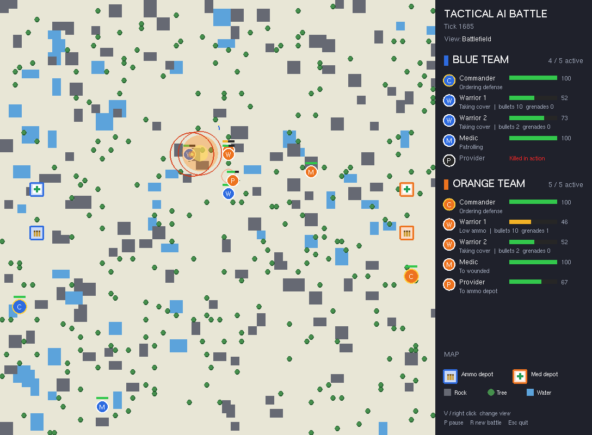
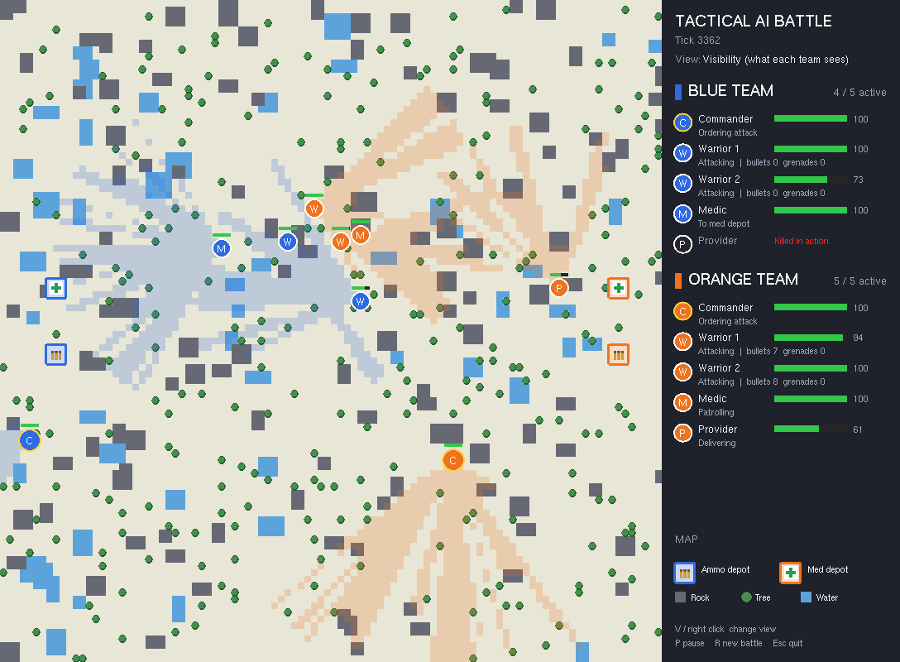
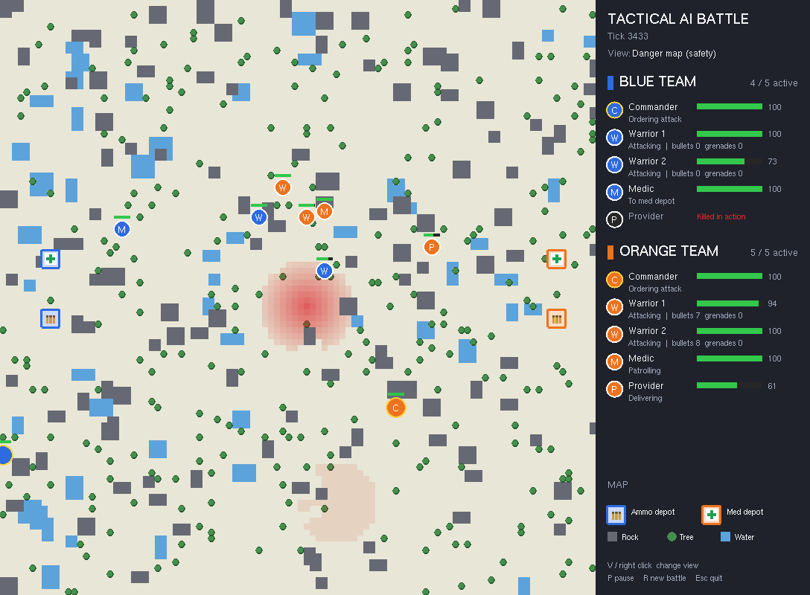

# Tactical AI Battle

A real-time battle simulation in C++ and OpenGL (GLUT) where two AI teams fight on a randomly generated 100×100 battlefield. Every unit is an autonomous agent with its own role, and nobody plays it: commanders plan, warriors fight, medics heal and providers keep the front line supplied.

## Demo

https://github.com/user-attachments/assets/1a266451-5b22-45dd-8470-666f98f00b3e

*Blue and orange teams patrol, spot each other and engage. Tracers show shots, rings show the real grenade blast radius, and the side panel tracks every unit's health, state and ammo.*

## The teams

Each team (blue and orange) has five units, each driven by its own finite state machine:

| Unit | Role |
|---|---|
| **Commander** (gold ring) | Combines what the whole team sees, decides between attack and defense, sends orders to the warriors, and moves between cover positions. |
| **Warrior** ×2 | Patrols, advances, attacks and takes cover. Shoots enemies in line of fire and throws grenades at groups of enemies or at targets behind cover. Reports when wounded or low on ammo. |
| **Medic** | Picks up supplies at the team's med depot and heals wounded teammates. Works on its own if the commander falls. |
| **Provider** | Brings bullets and grenades from the ammo depot to warriors who are running low. |

A team loses when it can no longer fight, meaning it has no warrior left with ammo or a provider to resupply one.

## AI techniques

- **A\* pathfinding** weighted by a **danger (safety) map**, so units prefer routes away from recent fire and explosions.
- **Danger map** built from bullets, grenade blasts and random "decoy" threats, decaying over time.
- **BFS cover search** for the nearest cell that enemies cannot see and that is not too dangerous.
- **Line of sight / line of fire** with Bresenham lines (rocks and trees block both).
- **Field-of-view cones** per unit, merged by the commander into one team picture.
- **Finite state machines** for every role, with the commander coordinating the rest.

## Views

Press `V` (or right-click) to switch between three views:

<table>
  <tr>
    <th align="center">Visibility: what each team sees</th>
    <th align="center">Danger map used for pathfinding</th>
  </tr>
  <tr>
    <td></td>
    <td></td>
  </tr>
</table>

The side panel shows every unit's health, current state, and (for warriors) remaining bullets and grenades.

## Controls

| Key | Action |
|---|---|
| `V` / right click | Change view: battlefield, visibility, danger map |
| `P` / `Space` | Pause |
| `R` | New battle on a new map |
| `Esc` | Quit |

## Build and run

Requirements: Windows and Visual Studio 2022 (C++ desktop workload).

1. Open `Graphics.sln`.
2. Build and run (F5). The bundled freeglut library is 32-bit, so the solution always builds the x86 version (selecting x64 maps to it as well). A post-build step copies `freeglut.dll` next to the executable.

## Project structure

| File | Purpose |
|---|---|
| `main.cpp` | Window, fixed-rate game loop, keyboard and mouse |
| `Game.cpp/.h` | Map generation, teams, combat, danger map, win condition, side panel |
| `Commander.cpp/.h` | Team strategy, combined vision, orders, cover hopping |
| `Warrior.cpp/.h` | Warrior state machine |
| `Medic.cpp/.h`, `Provider.cpp/.h` | Support roles |
| `Character.cpp/.h` | Shared unit logic and movement along paths |
| `AI.cpp/.h` | A*, BFS cover search, line of sight, field of view |
| `Bullet.cpp/.h`, `Grenade.cpp/.h` | Projectiles and explosions |
| `Graphics.h` | Drawing helpers for the map, units and overlays |
| `Definitions.h` | All tunable parameters: map size, ranges, damage, speeds, colors |
